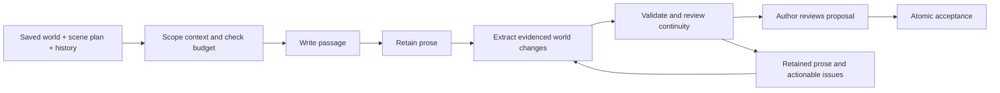

# Guided Story 2 — review and proposed design

Initial design pass: October 25, 2026; composable-node revision: October 28. This document records the target design for a fresh application, using Guided Story as a behavioral reference. Current implementation and verification are tracked separately in [FOUNDATION_STATUS.md](FOUNDATION_STATUS.md); planned behavior below is not a claim that every feature exists.

## Confirmed direction

- Build fresh rather than adapting the original engine.
- Make expandable location nodes the main authoring surface, connecting places, characters, items and story threads.
- Generate one scene/passage at a time, grouped into chapters.
- Use the same text and image APIs as Guided Story.
- Prioritize local LLMs around 30B parameters, including Qwen-class models. Target Krea 2, Z-Image and MOSS-Image families through ComfyUI, with Guided Story's existing workflow as the initial Krea 2 profile. Preserve model-specific workflows and sampling rather than assuming checkpoint interchangeability. See [model targets](MODEL_TARGETS.md).
- Provide deeper character customization; clothing consists of inventory items. Each item has one physical relationship: worn by, carried by, or stored inside. Wearing implies inventory membership without a second possession link.
- Unify story creation, the first passage and later chapter creation.
- Keep the world and story editable as writing progresses.
- Let the user submit a story idea and have the LLM fill in initial story settings and world records, followed by user revision before prose generation.
- Keep both manual edits and AI authoring tools available throughout the story, including creation of individual records and related groups such as a place populated with items.
- Connected creation is general, not limited to locations: a single character can be created together with their worn outfit, carried possessions and nested container contents.
- Separate Build a world from an idea from Create a connected group. Groups can request a small mixed bundle or restrict additions to a saved node type, such as items, while linking to existing records supplied as read-only context. Both use the same proposal review/Apply flow.
- Group creation checks a compact existing-world index and relevant records/belongings automatically. The current selection starts as a full-detail reference; additional explicit references require complete facts. Show coverage and omissions, reuse supplied existing identities as read-only targets, and keep existing-record edits separate from creating additions.
- Support explicit anatomical descriptions for adult characters, including breasts and genital anatomy, as optional persistent appearance details available to image preparation.
- Provide AI reroll options for existing characters, items, locations and other supported records, including targeted fields and connected groups.
- Retain a world-state record for every accepted scene/passage, with chapter-based table of contents and backward/forward navigation through written material.
- Use JSON files for saves and application data; image assets remain ordinary image files.
- Build an installed desktop application with Tauri + Svelte.
- Target Windows first; other platforms are outside the initial release's testing and packaging scope.
- Store each story in a self-contained, user-selected project folder, separate from application connection settings.
- Automatically save valid manual edits and unfinished drafts. AI world proposals require Apply; generated prose requires Accept passage before entering canon.
- Support wording edits throughout the story, latest-passage event replacement and earlier-event changes through a fork into a new story.
- Use a single **Fork after this passage** action for recovery from accepted world edits/rerolls/group additions, rather than operation-level undo or separate chapter/before/after fork variants. Ordinary text-edit undo remains available.
- Let AI suggest chapter endings, allow the user to keep a chapter open or close it, and offer an editable next-chapter plan before writing its first passage.
- Support character portraits and story illustrations. Characters live in the world map and shared entity inspector, without a separate cast-panel system or alternate character-management screen.
- Model the world as an extensible node toolkit: places, characters, items and threads are presets over shared nodes, with reusable capabilities and typed relationships. Support custom types and fields; container behavior is an addable item/node capability, not a separate fixed entity class.
- Keep basic behavioral capabilities small. Standard presets bundle reusable descriptive extensions so a normal character immediately offers profile, appearance, personality, motivation, voice and current-state sections. Custom presets use the same tools and contracts.
- The next node revision may require fresh stories. Compatibility/import/migration for older prototype story formats is not required. Immutable history and safe publication remain required within the new format; existing project folders are not deleted automatically.

All choices below are recommendations unless explicitly included above.

Pre-implementation review: [REVIEW_AND_BUILD_PLAN.md](REVIEW_AND_BUILD_PLAN.md) records resolved gaps, implementation contracts, delivery gates and deferred work. It refines technical details without changing the confirmed product decisions above. No implementation or test results are implied by that review.

## Composable-node revision

[WORLD_NODE_DESIGN.md](WORLD_NODE_DESIGN.md) specifies richer bundled presets, field semantics and single ownership of facts, useful places/items/threads, typed relationship properties, knowledge/source boundaries, compact capability-driven editing and shared task projections. Its capability/default-preset, typed-relationship, Event/source, Visual style/direct-image and initial situated-claim slices are implemented in story format 2; the checkpoint and remaining slices distinguish actual behavior from target design.

Additional core presets cover Organization, Lore, World rule, Event, Story brief and Visual style alongside Narration style. They are available creation bundles, not mandatory instances or separate collections. Events reference established history; future plans remain plans. More specialised presets can follow without changing the base-node model. A preset catalogue update must never silently rewrite existing instances or saved historical schemas.

## What the reference actually does

Reviewed source: `Ditters1234/guided-story`, commit `fdde895854875c431c8ae54eda637041e9a09bc3`.

| Area | Observed behavior | Design consequence |
| --- | --- | --- |
| World map | A location-first map is documented, but no canvas is implemented. Workflow contracts and a default graph exist as descriptors only. | Treat the map as a new feature. Separate fictional connections from generation-stage dependencies. |
| Character profiles | Structured appearance, personality, voice, motives, history, immediate state and condition already exist. | Deeper customization should add useful authoring controls, relationships and reuse rather than simply more fields. |
| Clothing | `wardrobe` contains four text regions, with derived outfit prose. Inventory has separate items and a Boolean `equipped`. | Replace the duplicated clothing truth with garment items and wear assignments. |
| Inventory | Immediate storage, nested containers, stack splitting, quantities and validated transfers exist. | Preserve these semantics in the new design. A bag's contents move with the bag. |
| Opening | `generatePassage` already handles both setup and story sources. Opening has a separate context path, setup publication and persistence operation. | A single generation entry point alone does not create a unified experience. Use one persistent story aggregate from the start. |
| Chapters | Chapters contain multiple passages, and a passage can close a chapter. | Retain passage-sized generation and make chapter intent editable before the first passage of every chapter. |
| Editing | Current records can be edited; wording polish is reviewed. Event replacement is limited to the latest passage, and manual world edits invalidate its recovery baseline. | Make edit effects and recovery boundaries explicit; do not promise arbitrary historical rewrites in the first release. |
| Reliability | Retained prose, evidenced state changes, revision guards, operation receipts and atomic acceptance are present. | Reimplement these guarantees deliberately; they are core product requirements. |
| Images | Explicit ComfyUI jobs, selected subjects, editable shots and captured source facts. Historical clothing reconstruction is incomplete. | Capture passage-era character and outfit state from the outset. |

The repository's own next-milestone instructions favor evolving its engine. That applies to that project; the user's explicit choice here is a separate fresh application.

Source anchors: [map proposal](https://github.com/Ditters1234/guided-story/blob/fdde895854875c431c8ae54eda637041e9a09bc3/docs/LOCATION_NODE_MAP_IDEA.md), [profiles](https://github.com/Ditters1234/guided-story/blob/fdde895854875c431c8ae54eda637041e9a09bc3/src/lib/character-profile.ts), [generation](https://github.com/Ditters1234/guided-story/blob/fdde895854875c431c8ae54eda637041e9a09bc3/src/lib/server/story-generation.ts), [canon schema](https://github.com/Ditters1234/guided-story/blob/fdde895854875c431c8ae54eda637041e9a09bc3/src/lib/story.ts), [persistence](https://github.com/Ditters1234/guided-story/blob/fdde895854875c431c8ae54eda637041e9a09bc3/src/lib/server/repository.ts).

## The core experience

**Build the world, stage a scene in it, write a passage, then keep shaping both.**

The app opens an existing story or creates a durable story with zero passages. A premise is enough to begin; manual world creation also works. Suggested cast, places and opening situations populate an editable draft proposal. Accepted records appear on the map. No setup wizard becomes inaccessible once the story starts.

```text
Story title                 Chapter 2: working title          Settings
---------------------------------------------------------------------
World map / search           Scene plan / reader             Inspector

Ranch                       Viewpoint: Alex                  Stable aisle
  Stable                    Scene location: Stable aisle     Description
    Stable aisle            Cast: Alex, Erin                 Visual design
      Alex                  Intention: uncover the lie       Background
        Worn (4)            Tension: Erin needs to leave      Linked threads
        Carried (2)         Stop after: a revealing answer    Add subplace
      Erin                  Relevant: Letter, Missing mare    Add to scene
    Tack room               Direction: ...
  House
                            [Write next passage]
                            Latest prose / proposed changes
---------------------------------------------------------------------
Chapter outline / passage navigation / generation activity
```

Map, scene plan and reader are coordinated views of the same story. The inspector edits a selected entity; the reader can expand for distraction-free reading. Narrow screens switch between Map, Scene and Reader while preserving selection and drafts. Search and a keyboard-accessible tree provide an equivalent to the canvas.

Character nodes display a selected portrait thumbnail when available and a placeholder otherwise. Selecting one opens the shared entity inspector with a larger portrait, character details, worn/carried items, relationships and AI authoring controls. Search, scene participant references and character mentions can focus that same map node/inspector; they do not open another character-management interface. Collapsed or offscreen characters remain discoverable through the map's search/tree.

### One composer, including the first passage

1. Select or inherit viewpoint, scene location and participants.
2. Add dramatic intent, tension, a stopping point and optional references. A short direction alone should suffice; advanced fields are optional.
3. Inspect suggested context and resolve actual blockers. Referenced people are distinguishable from participants.
4. Write one passage through the shared generation pipeline.
5. Review prose and a concise world-change summary, then accept or request a revision.
6. Acceptance commits prose, world changes and continuity records together; return to the same workspace.

Confirmed acceptance policy: review generated passages before they enter canon. **Accept passage** commits the reviewed prose and validated changes; AI world proposals use **Apply**. Manual edits and unfinished drafts save automatically. Incomplete or invalid form values remain recoverable drafts rather than corrupting canonical records; show saved/saving/failed and draft-versus-applied state clearly. Applying or accepting uses the explicitly saved reviewed version, with revision checks against concurrent edits.

Editing a passage candidate manually or through AI invalidates its extracted changes, evidence and checks. Retain the edited prose, then recheck that exact text before enabling acceptance. Changing the source world or generation-relevant settings marks dependent proposals stale; preserve them but do not accept old checks. Layout, reading position and portrait selection alone do not change the world-source revision. Flush pending valid author edits before taking a generation snapshot; unresolved invalid source forms require an explicit choice to fix them or use the saved version.

The first passage has no prior prose; later ones have history. Those are input differences, not different authoring flows. A new chapter has a new chapter brief, with inherited current world state. An empty draft chapter does not become a written chapter until a passage is accepted. Closing a chapter updates its pacing status; it does not generate more text by itself.

AI can suggest a natural chapter ending, while **Keep chapter open** and **Close chapter with this passage** let the author direct pacing. On starting the next chapter, present an editable chapter plan in the existing composer. Inherit relevant direction locally; an AI-generated plan is an explicit action rather than a hidden model call. The user can use it, revise manually, request AI revisions or proceed with minimal direction. Do not require a separate setup wizard or generate prose merely by opening that plan.

### Chapters, contents and reading navigation

Keep chapters as ordered collections of accepted passages. Each passage is a saved writing unit; a dramatic scene may span several passages, so optional scene grouping must not erase the world-state boundary at each acceptance. The reader can label these units as scenes/passages consistently without requiring a whole dramatic scene in one model response.

Provide a table of contents with chapter titles, draft/open/closed status, chapter word counts and expandable passage entries showing titles and word counts. Planned chapters are distinguishable from written chapters. Selecting a written entry opens its prose, illustrations and historical world view. Resume returns to the last-read passage, with a separate **Latest passage** shortcut.

**Previous** and **Next** navigate only accepted passages, crossing chapter boundaries naturally. Optional previous/next chapter shortcuts jump to the first written passage in an adjacent chapter. Disable Previous at the beginning and Next at the latest passage. **Write next passage** is a separate authoring action; reading forward never triggers generation. Draft proposals stay out of the written reading sequence.

At any selected passage, the world map and inspectors can show **Before this passage** or **After this passage**, with After as the default historical view. Display the chapter/passage and a clear historical-state label. **Current world** returns to the latest editable world, which may contain manual changes made since the last passage. Historical reading does not roll back the story, redirect a pending generation or change the current world. Writing from an earlier point requires an explicit checkpoint copy or supported revision action.

Every accepted passage stores immutable references to complete before/after world snapshots, its scene-plan version, accepted effects and source revision. Snapshots include characters and physical details, locations, items and wear assignments, relationships, threads, lore and character knowledge. Manual author edits create their own world revisions between passages; the next passage's before snapshot includes those edits. Store content preferences and author constraints with versioned story settings, so historical facts can be inspected while generation always enforces current applicable constraints.

Wording polish creates a new passage text version while retaining its event snapshots. Event replacement records new snapshots and preserves superseded versions for provenance. Historical images resolve against the relevant passage version and scene anchor. Before/after snapshots describe passage boundaries; events within the prose may still require an explicit image anchor to determine the correct intermediate state.

World creation and prose creation remain distinct operations inside this workspace. The author can request a cast proposal without advancing events, at any point in the story.

### Idea to editable story foundation

The user can enter a freeform story idea, with optional constraints, and choose **Develop story idea**. The LLM proposes a coherent starting foundation:

- Working title, premise, genre/tone, narrative voice, tense/person and suggested passage/chapter lengths.
- World foundations, starting locations and subplaces, cast and relationships.
- Starting possessions, individual garment items and valid wear assignments.
- Initial story threads, a proposed chapter intention and the first scene plan.

The result opens in the regular map, inspector and story settings, with proposed records clearly marked. The user can manually edit any part, request targeted AI revisions, remove suggestions, add records or regenerate selected portions. Whole-foundation regeneration is an explicit choice; it must not silently replace carefully edited characters or places. Content preferences and protected facts remain user-controlled.

**Apply foundation** accepts the reviewed settings and world without writing prose. **Write first passage** then uses the ordinary scene composer. Saving or accepting a foundation never starts prose or image generation automatically. The user can return to world authoring before writing, and unfinished proposals survive reload.

### The same authoring tools throughout

The map and inspector offer **Add manually**, **Create with AI**, and **Revise with AI** before and after the first passage. An AI action takes a direction, explicit target/scope and selected context, then returns an editable proposal. The author chooses when to apply it. AI assistance can be used for one field, one record, selected records or a connected group.

| Action | Example | Proposed scope |
| --- | --- | --- |
| Create one record | “A battered brass lantern in the stable.” | One item with the selected place as its proposed holder. |
| Create a character and belongings | “A traveling herbalist with practical clothing, a satchel and remedies.” | One character, individual worn garments, carried items and contents stored inside the satchel. |
| Revise one record | “Make this inn more prosperous, retaining its name and owner.” | Selected editable fields; existing linked records stay intact. |
| Create a furnished place | “A tack room with practical supplies and a locked cabinet.” | One place, optional subplaces, containers and items with valid storage links. |
| Populate an existing place | “Add everyday kitchen supplies to this room.” | Proposed items/containers within that location; existing contents remain. |
| Create a cast group | “Three rival merchants and their traveling possessions.” | Characters, relationships, item-based outfits and carried items, with proposed placement. |
| Expand a location group | “An inn with guest rooms, staff and furnishings.” | An explicitly selected mix of subplaces, characters, possessions and optional threads. |
| Revise a selection | “Weather these four garments without changing their designs.” | Only the selected garments' requested condition fields. |

Connected creation can start from any supported entity or an unanchored concept. Show scope controls appropriate to that starting point: a character offers outfit / carried items / containers and contents / relationships / story hooks; a place offers subplaces / furnishings and supplies / people / their belongings; a container offers contents. The direction can request these connections directly without requiring every checkbox. Sensible counts keep the proposal manageable; the user can request a larger group explicitly. A “group” here is a creation bundle of linked records, not a new faction or permanent entity type. Factions can be designed separately if needed.

For a character bundle, preview the character with separate Worn and Carried branches and expandable containers. Each garment and possession is independently editable. Applying the bundle creates the profile, inventory, wear assignments and storage links together. The same tool can add a new outfit or travel kit to an existing character while preserving their identity and existing belongings unless replacements are explicitly requested. Replacing worn clothing must name where removed garments will go; it must not delete them implicitly.

### Reroll and redesign existing records

Every supported entity inspector exposes AI revision and reroll actions. **Revise** follows a supplied direction; **Reroll** proposes a different alternative within the current concept and constraints, with optional guidance. Neither requires deleting and recreating the record. Offer field-level actions near relevant fields and broader actions in the inspector:

| Scope | Examples | Preservation boundary |
| --- | --- | --- |
| Name only | Reroll character name, item name or location name. | Change only the name; preserve ID, details, contents and connections. |
| Selected fields | Reroll personality, face, garment design, room description or thread stakes. | Change only selected fields and show any proposed dependent corrections separately. |
| Whole record | Redesign a character, item, location, relationship or thread. | Preserve stable ID, protected facts and external connections unless explicitly included in scope. |
| Connected selection | Reroll an outfit, a carried kit or selected furnishings. | Preserve unselected belongings and records; preview wear/storage changes together. |
| Entity and connections | Redesign a character with outfit and carried items, or a location with selected contents. | Explicitly select which connected branches may change; preserve the rest. |

Rerolling a character alone does not silently replace their item-based outfit or equipment. Rerolling a place alone does not replace its inhabitants or inventory. Offer shortcuts such as **Reroll outfit**, **Reroll carried kit**, **Reroll furnishings** and **Redesign with belongings** where applicable, with the affected scope visible before generation.

Retain the current saved version while showing the candidate in an editable preview. **Reroll again** replaces the candidate, with a way to return to the previous candidate; **Apply** applies the reviewed changes, and **Discard** leaves saved facts intact. Preserve manual candidate edits through explicit keep-field controls rather than silently overwriting them on another reroll. Request a meaningfully different result without promising model-level randomness guarantees.

Protected fields apply to every scope, including explicit anatomical descriptions and garment designs. A reroll cannot silently bypass pins. Full redesign preserves operational state such as placement, quantities, storage, wear assignments and thread status unless those fields are explicitly selected for change. Existing records retain their IDs; newly proposed connected records receive new IDs. Replacing or removing existing connected records requires resolving incoming references and destinations rather than deleting them implicitly.

During an ongoing story, show changed facts and linked historical references and apply the established current-world edit policy. An optional AI continuity review may flag possible contradictions; do not promise complete semantic contradiction detection. A name or appearance reroll does not rewrite past prose, regenerate accepted pictures or erase historical snapshots. Failed, cancelled or stale rerolls retain the saved record and recoverable candidate. Use the same world-proposal and atomic apply mechanism as other AI authoring actions.

### Review connected proposals together

A bundle preview lists new records, changes to existing records and proposed connections. Selecting a proposed map node opens the same editable inspector. The user can revise or reroll one part while keeping accepted edits elsewhere. Existing records are referenced by stable IDs; generation should reuse an established innkeeper rather than create a second copy merely because the inn is being furnished.

Partial acceptance respects dependencies. Accepting a cabinet and its contents requires the destination room; excluding the room requires remapping its dependent records. Removing a proposed character requires resolving that character's clothing, placement and relationships. The preview explains these dependencies instead of applying a broken subset. Valid selected changes apply atomically, with a receipt and revision check.

Use one world-proposal representation for initial foundations, individual additions, bundles and AI revisions. Keep these authoring proposals distinct from prose-derived event proposals: the author may establish a new location directly, while changes extracted from prose require passage evidence.

During an ongoing story, accepting a newly authored place establishes it in the current world; it does not claim characters have visited it or know its secrets. A furnishing proposal describes current contents, not a purchase scene. Show changed fields and available historical references for review; semantic contradiction warnings are advisory, not a guarantee of detecting every conflict. New proposals never overwrite existing contents by default.

## Map as a story-crafting tool

The default map shows root locations. Expand only a focused neighborhood: subplaces, present characters, worn/carried possessions, containers, and linked threads. Remember layout separately from fictional state.

| Link | Exact meaning |
| --- | --- |
| Inside | Place containment, such as room inside house. |
| Present at | A character's current physical location. |
| Stored in / carried by | An item's immediate holder; this is not legal ownership. |
| Worn by | A wear assignment for an item directly held by that character. |
| Route to | Explicit navigability between places; containment alone never establishes travel. |
| Related to | Lore, relationship or story-thread association; not physical presence. |
| Planned for | A future scene's intended use of a record; not an accomplished event. |

Dragging nodes changes layout. Commands such as Move character, Transfer item, Wear and Connect route perform validated fictional changes. Show the action's effect before saving where it affects several records.

Selecting a node inspects it. **Add to scene** places a reference in the scene plan; **Include as participant** asks for active involvement. Neither silently teleports the character or transfers a needed item. If the scene begins elsewhere, offer a travel/arrival passage or an explicit author edit of current placement.

Threads link to relevant people and places, with open / paused / resolved status, stakes and an optional desired direction. A planned reveal, a character's suspicion and established world truth remain separate. A thread attached to a place should suggest material for a scene, without forcing it into every generation.

Recommended later additions: geographic coordinates, route travel durations and historical map playback. The first version needs explicit route links but no travel simulator.

## Deeper character customization

Use one capability-driven inspector with a compact overview and expandable details. The standard Character preset bundles these reusable extensions; the character participation capability itself remains small. Descriptive fields are optional and minor characters need not have complete biographies. See the [node revision](WORLD_NODE_DESIGN.md) for field ownership and composition:

- **Identity and appearance:** actual/apparent age, pronouns, species, build, complexion, face, hair, eyes, markings and optional author-defined traits. Unknown values remain unspecified.
- **Adult anatomical detail:** optional explicit descriptions of breasts, nipples, genital anatomy, body hair and other physical features relevant to accurate adult character imagery. Provide structured regions plus freeform detail, allowing precise author wording rather than forcing euphemisms or a preset body type.
- **Persona:** voice, mannerisms, values, habits, strengths, flaws, fears, wants, long-term motives and background. No mandatory numerical personality meters.
- **Relationships:** typed links with directional descriptions, obligations and unresolved tensions. Knowledge/secrets use explicit perspective records rather than becoming shared facts in a copied biography.
- **Current state:** feelings, immediate intention, injuries and visible condition. Location is derived from physical links, not a second editable field.
- **Knowledge:** facts known, beliefs and uncertainties, with sources; author secrets are visibly separate.
- **Wardrobe and possessions:** worn items, carried items, storage and named outfit presets.
- **Author controls:** protected fields, content preferences, targeted AI edits and reusable character templates.

Templates create new story-local instances with new IDs; editing an instance does not change the template or another story. AI revisions show a proposed field diff and preserve unrelated facts. Deep controls are optional; a quick character concept can create a useful starting draft.

Renaming preserves IDs. Existing prose is not silently replaced; show where a previous name may still be relevant. Generated suggestions never acquire canonical authority until accepted.

### Anatomical descriptions and image preparation

An adult character's physical profile can include explicit anatomical descriptions alongside ordinary appearance traits. These are persistent character facts, distinct from garment coverage, temporary condition, pose, expression and the composition of an individual image. Unspecified features stay unspecified; generation must not invent measurements or overwrite authored anatomy merely to complete a profile.

Support optional region-based descriptions and an additional freeform appearance field. These details can be entered manually or included in an eligible adult character design proposal, reviewed and edited with the rest of the character. Field protection applies to anatomical details as it does to other appearance traits.

Image preparation resolves the selected character's saved physical details together with worn items, their coverage and the shot's framing. Include applicable visible details in the image prompt. Do not describe covered anatomy as exposed or remove clothing merely because an anatomical field exists. Per-image overrides remain editable and do not change the saved character unless the author explicitly applies a profile change.

Show the resolved positive/negative prompts before submission, including the exact authored descriptions used and any adaptations. Keep detailed anatomical facts out of routine narrative context unless relevant to the requested scene; preserving a full physical profile does not require repeating it in every passage. Provider/workflow capabilities can differ, so retaining a description does not guarantee that every configured image model will render it accurately.

## Clothing is inventory

Every garment is an item with its own identity, visual design, condition and storage. Wearing uses references to existing items; a character has no independent editable wardrobe strings. Narration and illustration summaries are derived from worn items.

Recommended fields and relationships:

| Record | Minimum responsibility |
| --- | --- |
| Item | Shared node identity, inventory quantity/unit and descriptive extensions. Immediate holder comes from its one physical link; container behavior is an addable capability. |
| Garment details | Coverage regions, layer category, material/color/pattern, fit and mutable condition. |
| Wear assignment | Character ID, item ID, occupied regions, layer/order and optional worn state such as open or hood up. |
| Outfit preset | Named references to garment items; intention only until applied. |

Rules:

1. A worn item uses one physical Worn by relationship and represents one tracked garment unit. Wearing implies inventory membership. Split a stack before wearing one unit. A pair of boots may be one explicitly named unit.
2. Layering supports shirts under coats, dresses spanning regions and multiple accessories. Coverage regions are flexible enough for nonhuman characters. Avoid a rigid one-item-per-slot rule.
3. Wearing a coat does not erase the shirt beneath it. A visible-outfit projection accounts for framing and covered layers without inventing unseen details.
4. Taking clothing off changes its relationship to carried, unless a storage destination is supplied. Transfers replace the physical relationship atomically. Detach leaves an item unplaced.
5. Wearing a bag preserves its contained items and their storage paths.
6. Applying a preset checks availability and compatibility; missing items are listed rather than created or teleported. Preview proposed removals and additions together.
7. Protection can cover a garment's design or a wear assignment. Protecting appearance need not freeze all future outfit changes.
8. Clothes dirtied, torn, lost or exchanged in prose update the same item records. Sparse updates preserve unspecified details.

Quantities use an explicit unit such as one bottle or one pair of boots. Transfers/splits conserve those units; ambiguous amounts block exact stock updates rather than guessing. A depleted item becomes an inactive record with zero quantity and no wear assignment, preserving its ID and historical references. A full container cannot be deleted or depleted while leaving contents orphaned. Retiring a character/place requires resolving current placement/storage references; historical snapshots stay immutable. Wear coverage is a useful prompt projection, not a physical clothing simulator; image overrides remain available for ambiguous layering.

Illustrations resolve identity plus outfit and condition at the selected passage/scene point. Capture before/after state for accepted passages and retain exact facts and prompts for accepted images. Where a change occurs within a passage, use a scene anchor or request author review; an end snapshot alone cannot prove the outfit in an earlier moment. Imported historical passages without state evidence show uncertainty rather than borrowing today's outfit.

### Portraits and story illustrations

Use two contextual entry points into the same image-generation tools:

- **Character portrait:** select a character node, then generate or choose a portrait in its inspector. Portrait preparation uses the chosen character state, applicable visible details and framing; the author can edit the shot and exact prompt. Keep image history and allow selection of the displayed portrait without replacing the character record.
- **Story illustration:** choose Illustrate on a passage, select the scene moment/subjects and review the shot. Accepted images appear with their source passage in the reader. They use passage-era state and remain linked to the exact passage version and captured facts.

Image generation and rerolling an image produce media candidates, not character redesigns. Choosing a new portrait does not change anatomy, clothing, possessions or written events. If the author wants an image-derived physical change saved, use a separate explicit reviewed profile edit. All image actions are optional; missing or failed images never block writing or map access.

Preserve accepted image files and provenance when selecting newer portraits or replacing passages. If a portrait's captured appearance differs from the current character, indicate it may need refreshing and let the author choose; do not automatically queue another image. Historical map views must not present a later portrait as evidence of an earlier appearance: use an applicable historical portrait or a placeholder, with image history available for inspection. Any later image browser is a view of shared assets, not a second cast editor.

## Unified records and generation

### Chosen application stack

Tauri + Svelte is confirmed. Use a desktop window with a Svelte interface and native backend access to local JSON saves and configured model services. Proposed implementation choices are TypeScript/Vite for the interface, Svelte Flow for the map and Rust for backend persistence and generation jobs; these supporting choices remain recommendations. No browser-hosted server or SvelteKit server rendering is required for the desktop product.

Recommended domain objects:

Implementation refinement: `World` stores generic nodes, typed edges and project-local definitions for node presets, capabilities and relationship types. The named records below describe roles rather than separate hardcoded collections. Every node shares ID, name, supplementary story/visual notes and attached capability properties. Node presets bundle initial capabilities; instances can combine them. Small native behavioral contracts provide scene location, character participation, counted inventory, storage and clothing. Descriptive extensions supply profile, appearance, motivations, voice, condition and other fields. The native contract registry is separate from the optional preset catalogue. Custom capabilities define typed fields and declarative metadata without executing code. Saved schema definitions travel with snapshots/forks. Inventory and physical-placement validators remain mandatory for built-in semantics; custom display types do not bypass them.

- `Story`: stable ID, premise, preferences, revision, current world, chapters and accepted passages; zero passages are valid.
- `ChapterPlan`: title, dramatic intention, active threads, optional ending aim and draft/open/closed status.
- `ScenePlan`: viewpoint, intended location/participants, relevant resources, direction and stopping point. It is planning data, not current world state.
- `World`: characters, locations, route links, items, wear assignments, relationships, threads, lore and viewpoint knowledge.
- `WorldRevision`: immutable complete world snapshot plus change receipt and provenance; every accepted passage references its before and after snapshots, including any intervening manual-edit revisions.
- `GenerationRun`: source revision, exact scene-plan version, request ID, stage outputs, attempt lineage, diagnostics and retained prose.
- `PassageProposal`: prose, proposed world changes, evidence and check results, separate from accepted canon.
- `WorldProposal`: proposed setting edits and record creations/updates, explicit scope, dependency links, source revision and per-record user edits; shared by initial idea development and later manual/AI authoring tools.
- `MediaAsset`: image, selected subjects, passage/scene reference, resolved historical facts and captured generation settings.
- `WorkspaceState`: selection, expanded nodes and layout; excluded from model context selection unless explicitly meaningful.

All prose uses one logical operation: `writePassage(storyId, scenePlanId, expectedRevision, requestId)`. Continue, opening and new chapter resolve position from the same story. Latest replacement explicitly selects its pre-passage baseline; it is not a continuation with a special instruction string.



The retry arrow is an explicit supported recheck, with one bounded automatic repair per attempt. Retries cannot bypass current pins, source revisions or evidence. Context selection uses the scene's participants, local resources, selected threads, relevant history and required constraints. Expanding the map does not send its whole contents to the LLM.

Required constraints that exceed the budget block generation with an explanation. Narration, extraction and image preparation use different scoped projections. Keep all three inspectable. Start with a fixed generation pipeline; a user-editable workflow canvas is outside the initial product scope.

### JSON saves and application data

Use versioned, readable UTF-8 JSON for canonical story data, world snapshots, settings, proposals, job records and workspace preferences. No database is required. Keep binary images as image files referenced from JSON. A proposed layout:

```text
data/
  settings.json                  application settings; private connection values
  library.json                   rebuildable story-list cache
  projects/<story-id>/            example only; each project may live in a user-selected folder
    head.json                    authoritative pointer to latest committed revision
    revisions/<revision-id>.json immutable story manifest: chapter order, passage versions,
                                 world/settings/media refs and committed request receipts
    worlds/<snapshot-id>.json     complete immutable world state
    passages/<version-id>.json    prose, chapter/scene IDs, before/after refs and effects
    plans/<version-id>.json       versioned chapter and scene plans
    settings/<version-id>.json    story settings and author constraints
    proposals/<proposal-id>.json  recoverable editable world/passage candidates
    jobs/<run-id>.json            durable run status, inputs, outputs and request identity
    workspace.json               layout, selection and reading position
    media/<asset-id>.json         source facts, prompt, settings and image references
    images/<image-id>.png         image assets, using actual generated file format
    backups/                     retained validated prior head/manifest references
```

The story manifest orders accepted text and selects the authoritative current world; a separate mutable current-world file must not compete with that pointer. Use immutable versioned records for accepted content. Keep full snapshots initially for straightforward inspection and recovery; unchanged before/after references may share a snapshot. Future storage compaction must preserve historical behavior and is not required for the first release.

JSON files need an explicit commit protocol because several independent writes are not one transaction. Serialize commits per story, check the expected revision, write all new referenced records to temporary files on the same filesystem, flush and finalize them, then validate their references and checksums before publishing the new manifest. Finally replace `head.json` atomically using a platform-tested filesystem operation. The head replacement is the commit point: readers use either the old complete revision or the new complete revision. Never publish the pointer before all its referenced records are durable.

Record request IDs and committed outcomes in the revision manifest so retries after a lost response return the existing result. A crash before head publication leaves harmless unreferenced candidate files; a crash after publication is recognized as committed even if the job status was not updated. A failed head replacement preserves the previous save and the generated draft. The native backend owns project access: one writable application instance per resolved project folder, enforced with an operating-system lock, plus short commit serialization and expected-revision checks. Another instance can report the project is in use. Do not hold a commit lock through model calls or human review; the project ownership lock lasts while it is open. Test normal process interruption and write failures; hardware/power-loss durability still depends on filesystem and flush behavior and must not be advertised as unconditional.

Retain a previous validated head and startup recovery checks. Malformed or missing referenced data must produce a recoverable error and an offered last-valid revision, never an automatic empty story. Every stored record has a schema version. The next node revision can require a fresh project format; older prototype migration is outside its requirements. If a later migration is deliberately added, preserve original files and validate the converted result before publication. Independently mutable drafts/settings use temporary-write-and-replace with stale-write checks as appropriate. The library index and read-position/layout state are rebuildable or noncanonical; a failure there cannot undo an accepted passage. Test interrupted writes and Windows file replacement explicitly during implementation.

Project export copies a consistent committed manifest and its referenced JSON/media records. Include enough historical snapshots to preserve scene state; exclude private connection settings. Restoring/importing validates IDs, schemas and references before making a story visible.

The example tree is not a requirement to keep projects under application data. A project folder contains all story manifests, snapshots, accepted text, required media, plans and recoverable local drafts. The application stores only a recent-project index and private global settings separately. **Open project** can register a copied/moved folder without requiring its previous absolute path. Use project-relative asset references and validate them against the project root. Copying a closed or consistently exported project folder is sufficient to move the story; a live ad-hoc copy is not guaranteed to capture one committed revision.

### API compatibility

Preserve compatibility with the reference's configurable OpenAI-compatible text service: `POST {baseUrl}/chat/completions`, model selection, optional bearer key, sampling/output/context settings and supported JSON/schema modes. Preserve its provider-specific thinking option as an optional capability, not an assumption for every server.

Preserve ComfyUI workflow JSON import/bindings and the `/object_info`, `/prompt`, `/history/{promptId}`, `/view` and connection-test `/system_stats` interactions. Persist each image job's original endpoint, prompt ID, workflow, seed and settings. Image generation stays explicit and never blocks accepting prose.

The new app's internal routes may differ; provider request compatibility is the requirement. Do not assume the user's saved connection values or keys are present in the reference checkout. Keep connection settings outside story exports.

## Editing and continuity policy

Offer explicit operations with different consequences:

| Operation | Expected behavior |
| --- | --- |
| Edit current world | Changes current facts with an author-edit receipt; does not rewrite previous prose. Warn about affected in-flight proposals. |
| Add planned material | Saves an intention or proposed entity without claiming an event occurred. Accepting a new record can establish it now; introducing it through prose remains optional. |
| Polish wording | Review a prose diff; preserve accepted events. Semantic checks are advisory and the author confirms wording-only intent. If events are altered, route to event revision. Re-anchor source evidence against the new text or mark old anchors stale; never present an obsolete quote as current proof. |
| Replace latest passage | Generate from its recorded baseline and current author constraints. Conflicting intervening edits require explicit resolution; never roll them back silently. |
| Revise older events | Initial release offers a story copy from a checkpoint; broad in-place downstream rewrites remain deferred. |
| Recheck retained prose | Re-extract against the currently selected valid baseline without silently renarrating. If prose itself conflicts, offer rewrite or discard. |

Immutable passage versions preserve earlier text and image provenance. Changed prose invalidates derived memories/recaps as needed. Snapshot-based views of the past are read-only. One story remains linear in the initial release; checkpoint copies do not require a branching editor.

### Passage forks and recovery

Provide one action, **Fork after this passage**, in the table of contents and reader. It keeps all accepted prose through the selected passage, starts from that passage's saved after-state and creates an independent story for a different continuation. To change a later passage or chapter, select an earlier passage. Do not add before-passage, chapter-level or current-world fork modes. Historical before/after inspection remains separate from this action. Forking requires a selected accepted passage; copying an unwritten foundation is outside this fork flow.

Before creating the copy, show the selected passage, which chapters/passages will remain and which later material/current manual edits will be absent. The saved after-state is the fixed boundary, not an additional choice. Ask for the new story name and project folder as part of that action. Create an independent self-contained project with a new story ID, retaining story-local entity IDs and recording optional origin metadata. Do not require the parent project to stay present and do not modify it. Preserve the selected passage's chapter open/closed status so continuation either resumes that chapter or proceeds to the next chapter plan naturally.

Retain only the selected accepted history, world state and applicable plan versions. Memories, recaps, knowledge and image references must match that history: omit or rebuild summaries covering later passages, and do not carry future discoveries or future outfits into the fork. Include the media needed by retained history; omit later-only media, pending jobs, future proposals and committed request identities from the parent's active operation namespace. Preserve current application-level preferences separately from historical story facts.

Forking provides recovery from an unwanted character reroll, world edit or bundle application by returning to the selected passage's after-state. It deliberately may omit other changes since that passage; make that cost visible before creation. A fine-grained undo stack for accepted operations is deferred. Text fields retain normal typing undo, and unaccepted AI proposals remain discardable without forking. Latest-passage replacement remains available where its baseline is valid; otherwise offer **Fork after this passage** on an appropriate earlier passage.

## Other gaps to settle or cover

| Gap | Recommended default |
| --- | --- |
| Empty workspace | Offer Start manually, Suggest a world and a small fictional example; never require AI to create a first record. |
| Authoring friction | Automatically save valid manual edits and unfinished drafts, show saved/saving/failed state, and use revision checks. AI actions use a named saved version; failed saves retain local typing. |
| Generation failure | Keep completed prose; explain whether the issue is provider access, format, evidence, availability or stale facts. Recheck only supported downstream stages. |
| Concurrent editing | Reject stale acceptance; preserve both the draft and a clear account of changes since generation began. |
| Cancel/reload | Persist jobs and operation receipts. Cancellation cannot undo an already accepted passage. Recover uncertain completion by request ID. |
| Secrets and viewpoint | Keep author truth, character belief and revealed information distinct in the inspector and context. |
| Narrative quality | Track active threads and recent beats; suggest neglected threads on demand. Do not invent offscreen events merely to update a map. |
| Movement and time | Distinguish containment from routes and planned arrivals from current placement. Use an optional story-time label initially; defer calendar simulation. |
| Entity deletion | Show incoming links; retire established entities or require explicit remapping. Preserve historical snapshots and media references. |
| Scale | Search, collapsed subtrees, focus current scene, selective overlays and a tree/list alternative. Never draw every nested item by default. |
| Portability | Versioned project export includes world, plans, accepted passages, relevant revisions and media. Back up recoverable drafts separately; exclude credentials. |
| Old project import | Defer full Guided Story import until its mapping is specified. Free-text wardrobe cannot reliably become individual garments without review. |
| Testing claims | Reuse reference scenarios as requirements, not evidence. This new implementation needs its own automated, browser and provider checks. |

## Delivery order and acceptance examples

1. **Story foundation:** prove JSON commits, interruption recovery, schema validation and project locking first; then stable zero-passage story, manual records, saves, revisions, text/image settings and idea-to-foundation AI proposals. Revise the generated foundation before prose; reload without losing IDs, drafts or review state.
2. **Map and inspector:** containment, placement, connected threads and nested inventory; individual and grouped manual/AI authoring, explicit scene planning and tree fallback. Generate a furnished room, revise only its cabinet, exclude one item and apply a valid bundle without altering existing contents. Expanding a bag does not change context or canon.
3. **Item-based wardrobe:** wear/remove/transfer, layers, presets and shared narrative/image projection. Transfer Alex's coat to Erin; Alex's derived outfit loses it, Erin carries it until wearing it, and no duplicate coat appears.
4. **Unified writing slice:** the same composer writes passage one, continuation and the first passage of chapter two. A failed extraction retains prose and changes no world facts; repeated acceptance commits once.
5. **Editing and history:** reviewed polish, latest replacement, author edits, full passage-boundary world snapshots and invalidation. Table of contents and Previous/Next navigate accepted prose across chapters without generation. Historical map state follows the selected passage; current-world edits do not alter it. An old illustration uses the outfit from its source scene; a new outfit does not alter accepted old images.
6. **Hardening:** JSON save interruption/recovery and head publication, cancellation/restart, another-window/instance conflicts, context limits, accessibility, export roundtrip and isolated real-provider probes.

The first useful end-to-end demonstration should be small: a ranch, two characters, two rooms, a layered outfit, a bag and a linked story thread. Create and edit them on the map; stage a scene; accept a passage with a coat handoff; verify physical state, worn state, history and image subject facts agree.

Also verify character-led creation: request a traveling herbalist with a layered outfit, a satchel and three remedies. Edit one garment and one remedy in the preview, then apply. The garments are worn item records, the satchel is carried, and remedies are stored inside it. Expanding the character exposes those exact records without duplicate profile clothing. Repeat against an existing character to add a kit without replacing unrelated possessions.

Verify reroll scope: reroll the herbalist's name without changing their ID, profile or belongings; reroll a coat design without changing its holder or worn state; reroll a room description without changing its contents. Redesign the character with selected belongings and confirm the preview contains all dependent changes, protected facts remain fixed, discarded candidates change no canon, and earlier passage snapshots remain intact.

## Remaining design details

Platform, project storage, autosave/acceptance, historical editing, passage-based forking and chapter transitions are confirmed above. The next node-model revision follows [WORLD_NODE_DESIGN.md](WORLD_NODE_DESIGN.md), with end-to-end field authoring/context/media checks rather than schema-only completion. Outfit presets are proposed as story-local initially, with reusable character templates. Additional platforms remain deferred.
